# 初期キーマップ
初期設定はJIS配列、オートマウスレイヤーありとなっています。  
ロータリーエンコーダーはどのレイヤーでも音量のUP/DOWNになっています。  

## レイヤー0
デフォルトのレイヤー  
「Z」の下に「Shift」と書かれているキーのように、2種類記載されているキーは、短押しと長押しで動作が変わります。  
この場合、短押しではZが入力され、長押しではShiftが入力されます。  
- キーの下側の数字：長押ししている間各レイヤーに切り替わる
- ↵ ：Enter
- BS：Backspace
- LANG1：ひらがな
- LANG2：半角英数字

## レイヤー1
ファンクションキー  

## レイヤー2
数字・記号キー  

> [!NOTE]
> Keymap Editor等GUI上で見ると異なっているように見えますが、実際入力されるものは画像のものになります

## レイヤー3
方向キーなど  

## レイヤー4
Bluetoothの設定や切り替えをする  
最大5台の端末にてマルチペアリングが可能です。キーボードの電源をオンにしたのちBT_SEL_0 ～ BT_SEL_4のいずれかを押して端末と接続してください。
- BT_CLR：選択中のBluetooth設定を初期化する
- BT_CLR_ALL：5個すべてのBluetooth設定を初期化する

## レイヤー5
縦スクロールレイヤー  
キーはデフォルトでは未割当です。  

## レイヤー6
マウスレイヤー  
組み立て済み品の場合オートマウスレイヤーが有効になっているため、トラックボールを動かした後にU、I、Oを押すとMB1、MB2、MB3になります。  
Y、U、I、O、Shift、Control、Alt以外のキーを押すとキー入力モードに戻ります。  
- MB1：左クリック
- MB2：右クリック
- MB3：中央クリック

### マウスジェスチャー
Yを長押ししながらトラックボールを動かすと、動かした方向に応じて以下の操作ができます。  
Yを短く押した場合は、通常どおり「Y」が入力されます。  
- ↑：次のタブ（Ctrl + Tab）
- ↓：前のタブ（Ctrl + Shift + Tab）
- ←：戻る（Alt + ←）
- →：進む（Alt + →）

## レイヤー7
マクロ・横スクロールレイヤー  
個人的によく使用するスクリーンショットやInsertを使用するコピー・ペースト等を設定しています。  

