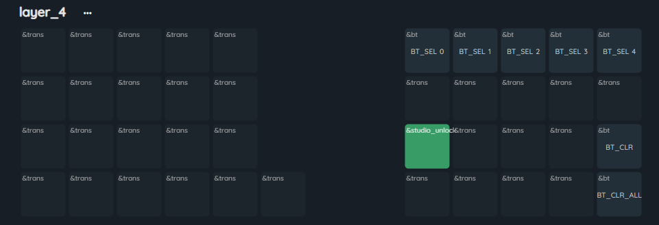
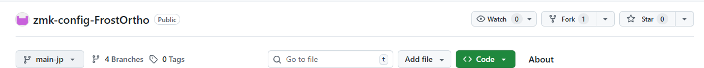
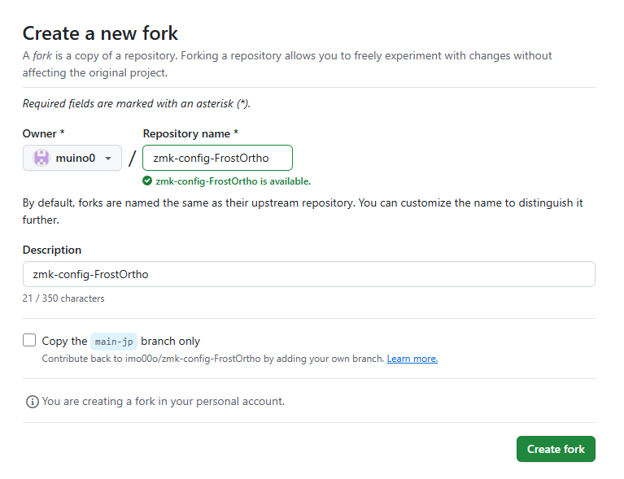
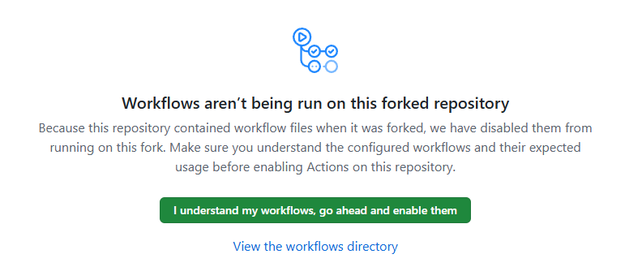
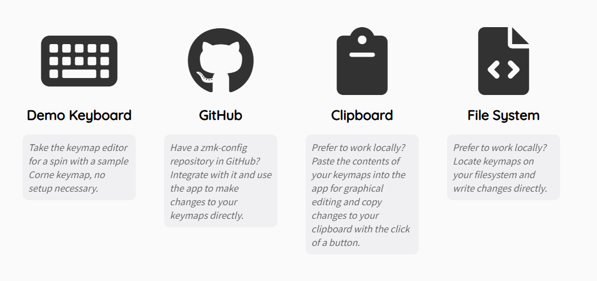
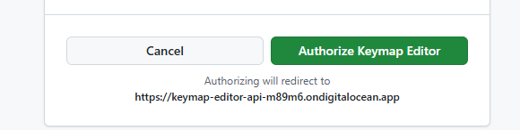
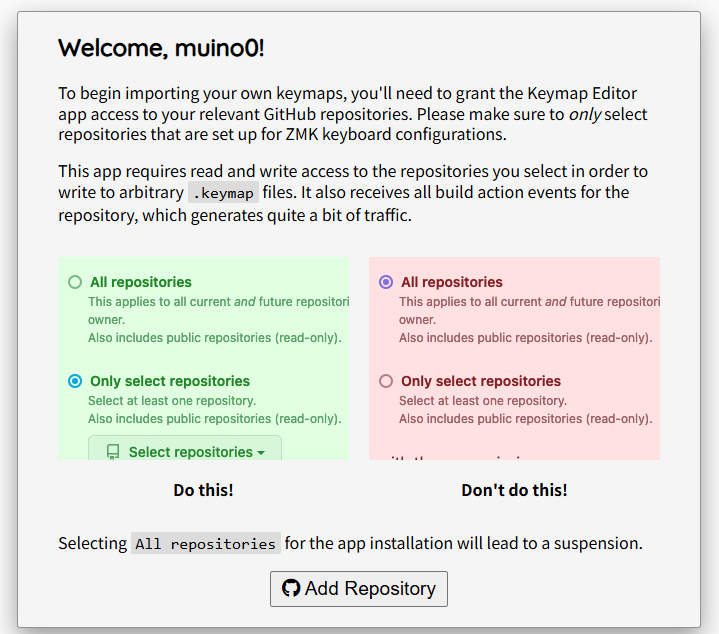
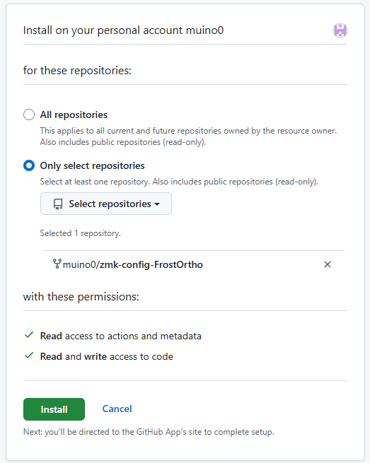
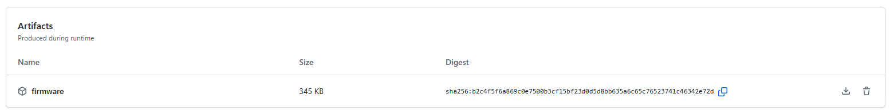

# キーマップの変更方法
Via等は使用できません。以下のいずれかの方法を実施ください。  

- [DYA Studio](https://studio.dya.cormoran.works/) で変更する　← おすすめ  
ブラウザ上で簡単にキーマップ・カーソル速度・スクロール・オートマウスレイヤー等の変更ができ、ファームウェアの書き込み作業が不要です。  
iPadでもBluefyというブラウザで使用するとBluetooth接続で使用可能です。  
  - [DYA Studio を使用したキーマップ変更方法](#dya-studio-を使用したキーマップ変更方法)  

- [Keymap Editor](https://nickcoutsos.github.io/keymap-editor/) で変更する  
GitHubアカウントの作成が必要になり、変更するたびファームウェアの書き込みが必要になります。  
キーマップの変更ができますが、トラックボール速度等は変更できません。  
  - [Keymap Editor を使用したキーマップ変更方法](#keymap-editor-を使用したキーマップ変更方法)  

- ファームウェアを直接書き換える  
自由に変更や設定追加ができます。  
マウスジェスチャーやエンコーダーの回転数など、DYA Studio で変更できない設定はファームウェアを直接弄っていただく必要があります。  
  - [ファームウェアの書き換え](#ファームウェアの書き換え)  

## DYA Studio を使用したキーマップ変更方法
1. [DYA Studio](https://studio.dya.cormoran.works/)にアクセスして有線もしくはBluetooth接続を選択する。  
   > ※ Bluetooth接続でFrostOrthoが検出されない場合、電源を一度オフにして再度オンにしてみてください。  
   > ※ iPadはBluetooth接続のみ可能です。
2. DYA Studioによる変更を許可するためにレイヤー4のstudio_unlockキーを押下する。  
     
3. キーマップやトラックボール設定の変更をして保存する。  
   > ※ マクロ&コンボは現状対応していません。

### トラックボール設定
DYA Studio のトラックボール設定には以下の3つが表示されます。  

| 名前 | 内容 | 主な設定項目 |
| ---- | ---- | ---- |
| mouse | カーソル移動 | 速度、移動方向の反転、オートマウスレイヤー（AML） |
| scroll | 縦スクロール（レイヤー5） | スクロール量、スクロール方向の反転 |
| hscroll | 横スクロール（レイヤー7） | スクロール量、スクロール方向の反転 |

### オートマウスレイヤー（AML）の設定
AMLは mouse の設定から以下を変更できます。  
- 有効/無効
- AMLとして使うレイヤー（初期値：レイヤー6）
- キー入力後、AMLに切り替わらない時間（初期値：400ms）
- AMLが解除されるまでの時間（初期値：65535ms。設定できる最大値です）

#### オートマウスレイヤーをオフにする
mouse の設定でAMLを無効にしてください。  
また、レイヤー1などにマウスレイヤー(初期値：レイヤー6)に移動するキーを設定してください。  

#### AMLから離脱しないキー
レイヤー6（AML）に &trans 以外が割り当てられたキーは、押してもAMLから離脱しません。  
レイヤー6（AML）に &trans を割り当てたキーを押すとAMLから離脱します。  

> [!TIP]
> マウスボタンの位置を変えたい場合は、DYA Studio でレイヤー6のキーマップを変更するだけで大丈夫です。

## Keymap Editor を使用したキーマップ変更方法
1. [ファームウェア用リポジトリ](https://github.com/imo00o/zmk-config-FrostOrtho)へアクセスする。  
2. 「fork」をクリックしてリポジトリをフォークする。  
     
3. 「Create fork」をクリックする。  
     
4. フォークができたら、Actions タブを開く。  
5. 「I understand my workflows, go ahead and enable them」をクリックし、GitHub Actionsを有効化する。  
     
6. [Keymap Editor](https://nickcoutsos.github.io/keymap-editor/)へアクセスする。  
7. GitHub を選択する。  
     
8. 「Login with GitHub」をクリックし、画面に従ってログインする。  
9. 「Authorize Keymap Editor」をクリックする。  
     
10. 「Add Repository」をクリックする。  
      
11. 「Only select repositories」を選択し、「Select repositories」からzmk-config-FrostOrthoを選択する。  
    Installをクリックする。  
      
12. キーマップの変更が終わったら、「Save」をクリックする。  
13. 「Latest」をクリックするとGitHub Actionsの画面へ遷移する。  
    ビルドが完了するとファームウェアのダウンロードが可能となるのでダウンロードする。  
      
    > ※ ビルドには2分程度かかります。

## ファームウェアの書き換え
[Keymap Editor を使用したキーマップ変更方法](#keymap-editor-を使用したキーマップ変更方法)の1~5を実施したのち、自由にファイルの中身を変更ください。  
変更内容をpushするとGitHubのActionsタブにファームウェアが出力されます。  

### エンコーダーの回転数変更
FrostOrtho.dtsi で変更できます。  
stepsとかtriggers-per-rotationを変更してみてください。

FrostOrtho.dtsi
```dts
left_encoder: encoder_left {
    compatible = "alps,ec11";
    a-gpios = <&xiao_d 5 (GPIO_ACTIVE_HIGH | GPIO_PULL_UP)>;
    b-gpios = <&xiao_d 0 (GPIO_ACTIVE_HIGH | GPIO_PULL_UP)>;
    steps = <24>;
    status = "disabled";
};
sensors: sensors {
    compatible = "zmk,keymap-sensors";
    sensors = <&left_encoder>;
    triggers-per-rotation = <10>;
};
```

## ファームウェアの書き込み方法
[Keymap Editor を使用したキーマップ変更方法](#keymap-editor-を使用したキーマップ変更方法)や[ファームウェアの書き換え](#ファームウェアの書き換え)を実施してファームウェアをダウンロードし、解凍したら以下の手順でキーボードに書き込みます。  

1. 右手側キーボードとPCをケーブルで接続し、リセットスティックを2回押す
2. XIAO-SENSE(D:)のウィンドウが表示されるため、以下ファイルをドラッグ&ドロップして書き込む
   - `FrostOrtho_R-seeeduino_xiao_ble-zmk.uf2`
3. キーマップ以外の修正をした場合は、左手側キーボードも同じ手順で以下のファイルを書き込む
   - `FrostOrtho_L-seeeduino_xiao_ble-zmk.uf2`
4. 正常に書き込みできれば完了

### エラー発生時
書き込み中にエラーが発生した場合は、以下リセット用ファイルを同様の手順で書き込んでください。その後、もう一度ファームウェアの書き込みを実施してください。
 - `settings_reset-seeeduino_xiao_ble-zmk.uf2`
