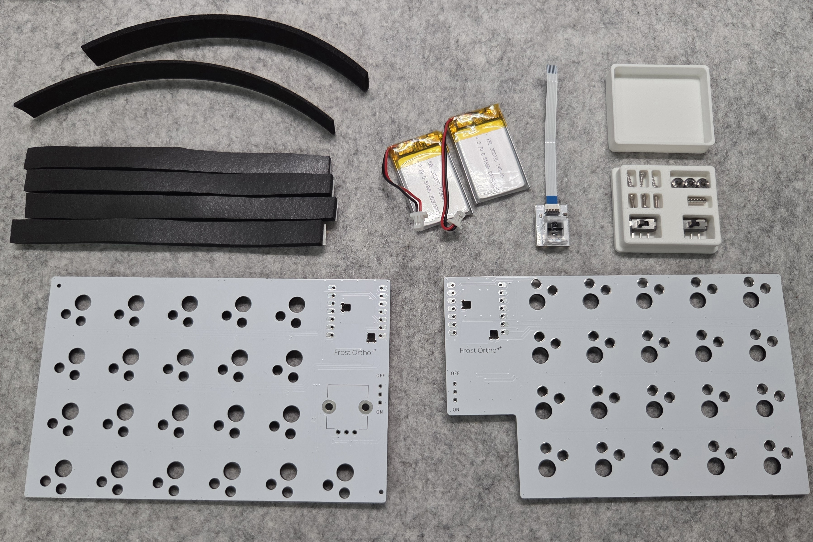
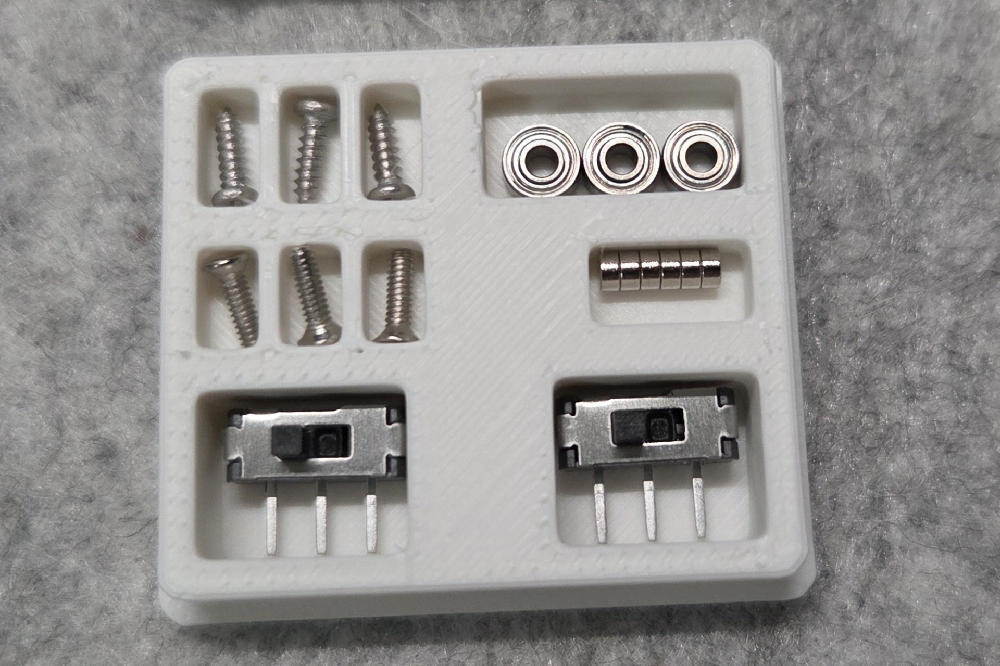

# 自作キット ビルドガイド

## 内容物
| 部品番号 | 部品名 | 数 | 説明 | 備考 |
| ---- | ---- | ---- | ---- | ---- |
| 1 | トップケース | 2（左右） | キーボードの外装 |  |
| 2 | ボトムケース | 2（左右） | キーボードの外装 |  |
| 3 | スイッチプレート | 2（左右） | キースイッチを固定するプレート |  |
| 4 | スイッチカバー | 2 | 電源スイッチのカバー |  |
| 5 | リセットスティック | 2～ | ファームウェア書き込み時に使用するスティック。小さく無くしやすいので予備も入っています。 |  |
| 6 | ノブ | 1 | ロータリーエンコーダーのノブ |  |
| 7 | トラックボールカバー | 1 | マグネットでケース本体とつけ外し可能 |  |
| 8 | 19mm PTFE球 | 1 | トラックボール |  |
| 9 | 基板 | 2（左右） | キーボードの基板 |  |
| 10 | 電源スイッチ | 2 | スライドスイッチ | [遊舎工房](https://shop.yushakobo.jp/products/5624?_pos=1&_sid=2c5ae4069&_ss=r) |
| 11 | リボンケーブル | 1 | センサーモジュールとメイン基板を接続する |  |
| 12 | センサーモジュール | 1 | 基板 + PAW3222LU-TJDU + PNSR-015-RB3 |  |
| 13 | センサーモジュール固定パーツ | 1 | センサーモジュールをケースに固定するパーツ |  |
| 14 | Lipoバッテリー | 2 | jst sh1.0コネクタ付き充電池 |  |

## 別途購入が必要
| 部品番号 | 部品名 | 数 | 説明 | 購入先例 |
| ---- | ---- | ---- | ---- | ---- |
| 1 | choc v2 キースイッチ | 41 | 3ピンのchoc v2 スイッチにのみ対応しています。4ピンのもの、choc v1には対応していません。 | 遊舎工房、TALP KEYBOARD、Lofree、JezailFunder、AliExpressなど |
| 2 | すべり止め | - | 底面に貼るすべり止め | 薄いのがよければ ⇒ [Amazon](https://www.amazon.co.jp/dp/B0CT8LCK52?ref=ppx_yo2ov_dt_b_fed_asin_title&th=1) |
| 3 | Seeed Studio XIAO nRF52840 | 2 | マイコン | 遊舎工房、TALP KEYBOARD、秋月電子など |
| 4 | Kailh Switch Socket choc(ロープロファイル)用 | 41 | choc用キーソケット | 遊舎工房、TALP KEYBOARDなど |
| 5 | ロープロファイルロータリーエンコーダー | 1 | 背の低いロータリーエンコーダー | [遊舎工房](https://shop.yushakobo.jp/products/2141?_pos=1&_sid=3c8fc5e4b&_ss=r&variant=37799941963937) |
| 6 | キーキャップ | 41 | 17mm狭ピッチのキーキャップ | 推奨：[LAK mini -ice keycaps-](https://shakupan.booth.pm/items/8963074) |

## 内容物確認
  
  
  

## 組み立て  
組み立て手順の[ケース準備](./組み立て手順.md#ケース準備)から実施してください。
